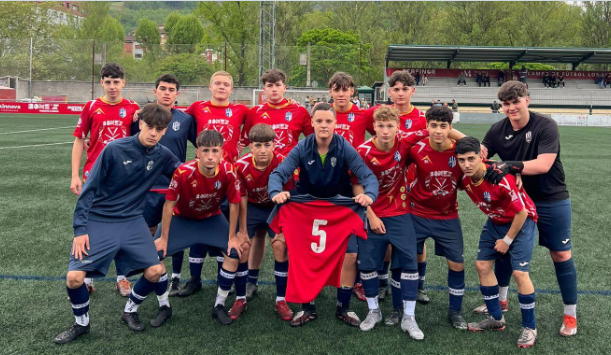
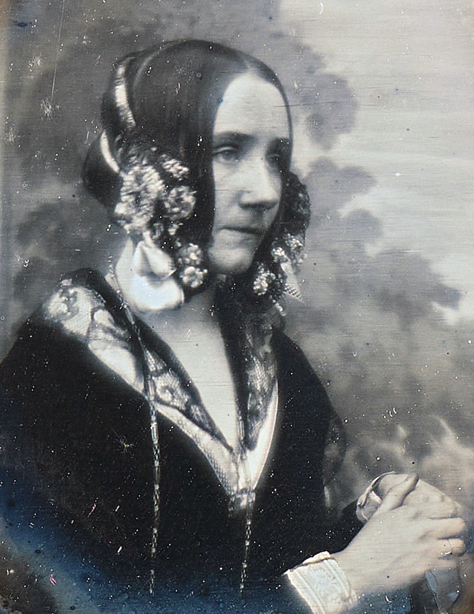

### 16/09 · Mis aficiones

LLevo jugando al futbol desde los 5 años, porque me gusta desde que soy pequeño.                                                                                                                                             Lo mas satisfactorio del futbol para mi es el progreso individual con el paso del tiempo                                                                                                                                       y cuando ganas en equipo y lo puedes disfrutar junto a ellos. Entreno los lunes, miércoles                                                                                                                                     
y viernes. También de vez en cuando me gusta jugar al pádel junto a mi padre y algún amigo                                                                                                                                  suyo.

Buscando en GitHub he encontrado [AntonRaichuk](https://github.com/google-research/football),
una pagina PARA SABER DE FUTBOL.

---
### 28/09· Premios Princesa de Asturias: Messi
Escogí a Messi ya que creo que es uno de los mejores futbolistas de la historia
y se merece ese premio. 
[Su pagina en la fundación](https://www.fpa.es/es/premios-princesa-de-asturias/premiados/2026-leo-messi/?texto=acta)
Aparte de lo deportivo como personas tiene unos valores muy buenos y se preocupa
por la gente que tienen una mala situación, por ultimo es una persona que influye 
mucho sobre los jóvenes ya que es un referente para muchas personas.

Imagen: UNESCO , [Wikimedia Commons](https://commons.wikimedia.org/wiki/File:Vanessa_Modely_Cristiano_Ronaldo_Lionel_Messi.jpg)

### 13/10 · Ada Lovelace
Ada Lovelace fue una matemática británica nacida en 1815. Es considerada una de las primeras programadoras 
de la historia porque escribió instrucciones para una máquina que realizaba cálculos.
[Ada Lovelace en Wikipedia](https://es.wikipedia.org/wiki/Ada_Lovelace) Su día se celebra el
segundo martes de octubre para reconocer a las mujeres en la ciencia y la tecnología. En 2026 fue el 13 de octubre.

{: width="300"}
*Imagen: Antoine Claudet, [Wikimedia Commons](https://commons.wikimedia.org/w/index.php?search=ada+lovelace&title=Special%3AMediaSearch&type=image))*

---

### 27/11 · Voyager 1

La Voyager 1 es una sonda espacial lanzada por la nasa en 1977.
Su misión era explorar Júpiter y Saturno y enviar información a la Tierra.
Actualmente, viaja por el espacio interestelar (https://es.wikipedia.org/wiki/Voyager_1),
más allá de nuestro sistema solar.

| Dato | Voyager 1 |
|---|---|
| Lanzamiento | 05/10/1977 |
| Distancia a la Tierra |25.902 millones km |
| Velocidad | 61.155 km/h |
| Lo que tarda su señal en llegar | 24 horas |
| Años de viaje | 49 años |

!Disco de oro voyager](capturas/voyager.jpg){: width="300"}
*NASA/JPL. Imagen: NASAJPL, ((https://commons.wikimedia.org/w/index.php?search=voyager+1&title=Special%3AMediaSearch&type=image))*

**Mi Disco de Oro 2026**

